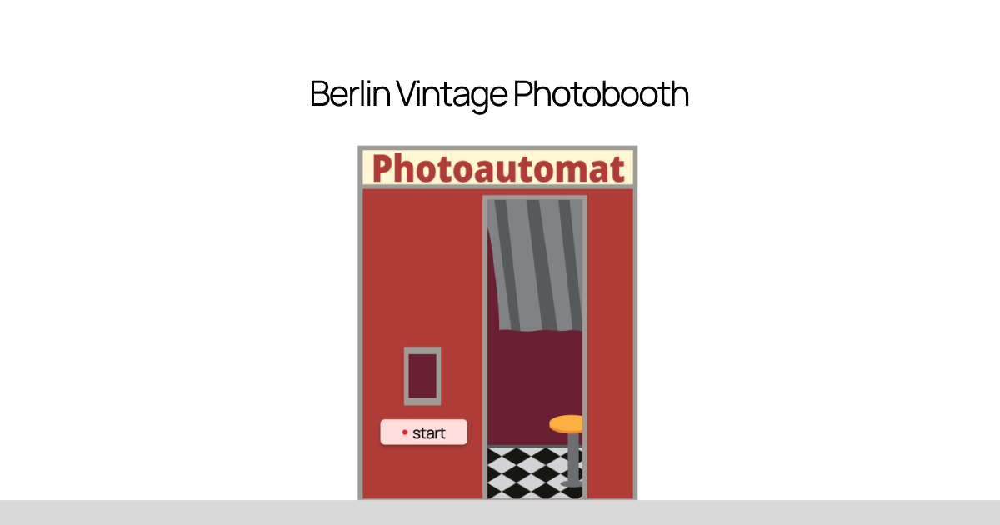

# Berlin Vintage Photobooth

A digital photobooth inspired by the vintage Photoautomat booths on the streets of Berlin.

**[Try it → berlinvintagephotobooth.com](https://berlinvintagephotobooth.com/)**

## The idea

In a real Photoautomat you never know how the pictures will turn out. You sit down, the flash goes off four times, and a few minutes later a strip drops out of the slot. This project keeps that feeling: there is no camera preview, and you only see your photos once the strip has been printed.

## How it works

1. Press **start** and allow camera access.
2. A 3-2-1 countdown runs before each of four shots, with a flash and a shutter sound.
3. The strip is printed and slides out of the *Photoausgabe* slot.
4. Download your strip as a PNG, or press **repeat** for another round.

Every strip comes out a little different. Each frame gets its own exposure, uneven development and film grain, and sometimes a light leak, a stain or a hair on the print. The frames sit slightly crooked and the edges are cut unevenly, like on a real machine.

## Privacy

Your photos never leave your device. Nothing is uploaded or stored: the strip is created in your browser and disappears when you close the page. Fonts are self-hosted, so the page makes no requests to third-party servers.

## Built with

- Plain HTML, CSS and JavaScript, no frameworks and no backend
- Camera via `getUserMedia`, photo processing on `<canvas>`
- Shutter and paper sounds synthesised with the Web Audio API, printing sound from Freesound
- Hosted on GitHub Pages

## Credits

Design and concept: [Aleksandra Novikova](https://aleksandra-novikova.com)

Fonts: [Manrope](https://github.com/sharanda/manrope) and [Open Sans](https://github.com/googlefonts/opensans), both under the [SIL Open Font License 1.1](fonts/OFL.txt).

Printing sound: [Old video camera](https://freesound.org/people/JoMungus/sounds/718650/) by JoMungus, [CC0](https://creativecommons.org/publicdomain/zero/1.0/).
